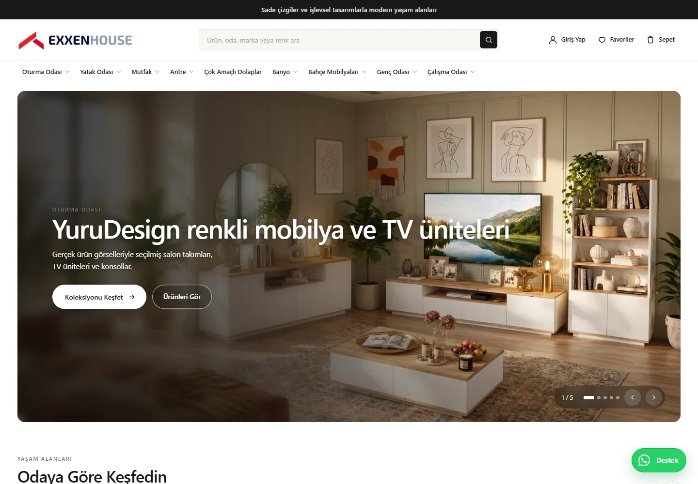
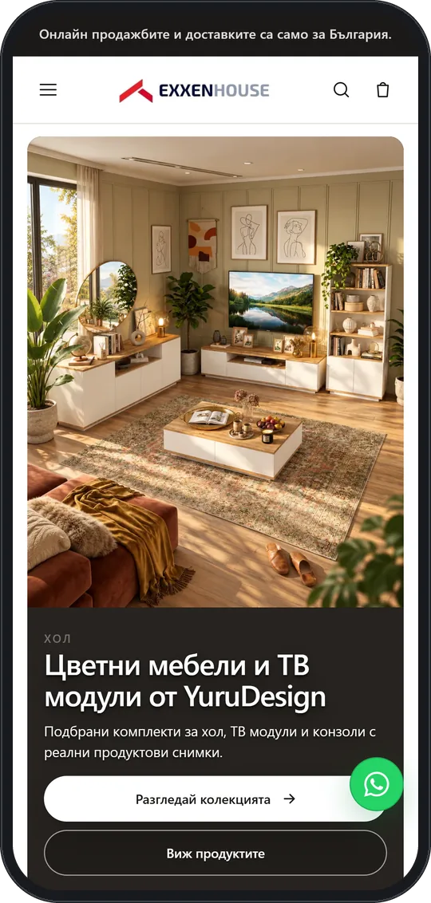

# Exxen House

A furniture commerce experience for discovering contemporary products by room, collection, and category.

**[Visit live website](https://exxenhouse.com)**

## Highlights

- Room-led furniture discovery and curated collections
- Search, favourites, account, and cart entry points
- Responsive Bulgarian storefront with product-focused navigation
- Real product photography across desktop and mobile layouts

## Verified technology

Shopify storefront and theme technology, confirmed from the live public site and the corresponding local project configuration.

## Live interface

 

## About this repository

This is a presentation-only repository containing selected public screenshots, this README, and a small static introduction page. Application source and private configuration are not published here.

Visual content and brand assets remain the property of their respective owners. See [LICENSE](LICENSE).
