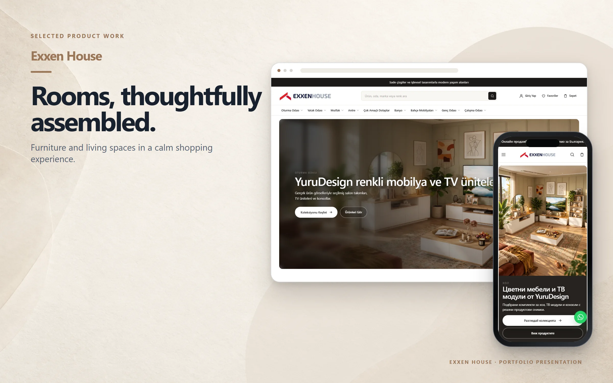
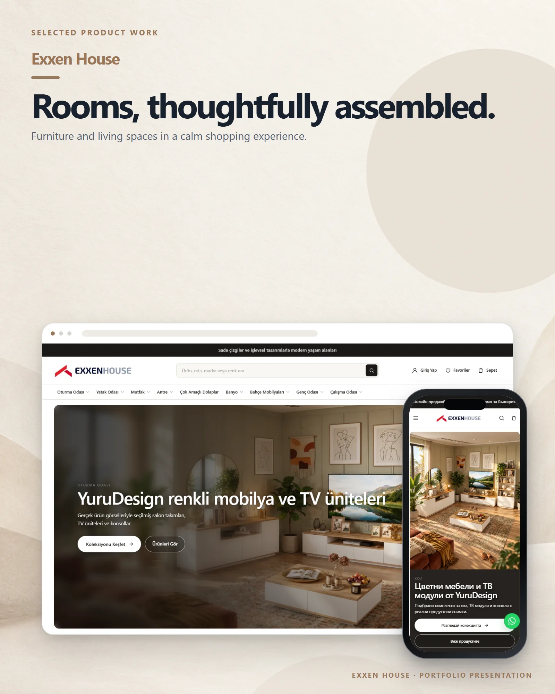

# Exxen House

A furniture store for discovering contemporary products by room, collection and category.

**Live:** [exxenhouse.com](https://exxenhouse.com) &nbsp;·&nbsp; **More work:** [github.com/mertomeroglu](https://github.com/mertomeroglu)

### Highlights

- Room-led furniture discovery and curated collections
- Search, favourites, account and cart entry points
- Responsive Bulgarian storefront with product-focused navigation
- Real product photography across desktop and mobile layouts

### Built with

Shopify · Liquid

---

Presentation-only repository: this README and two presentation images built from real product screens. Application source and private configuration are not published here. Visual content and brand assets remain the property of their respective owners — see [LICENSE](LICENSE).
