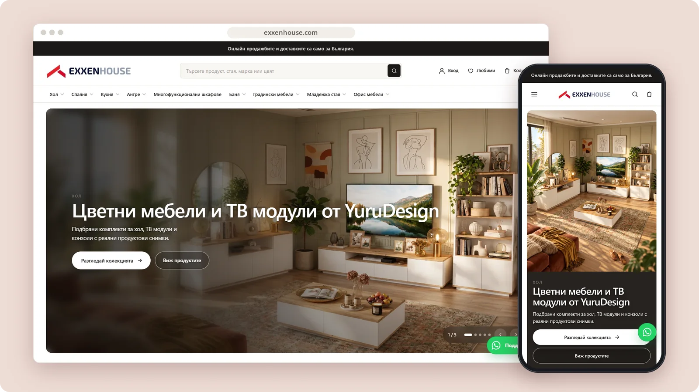

# Exxen House

A furniture store for discovering contemporary products by room, collection and category.

**[Visit exxenhouse.com ↗︎](https://exxenhouse.com)** &nbsp;·&nbsp; [More work by Mert Ömeroğlu](https://github.com/mertomeroglu)

### Highlights

- Room-led furniture discovery and curated collections
- Search, favourites, account and cart entry points
- Responsive Bulgarian storefront with product-focused navigation
- Real product photography across desktop and mobile layouts

### Built with

Shopify · Liquid

### Screens

---

Presentation-only repository. Images are real, unmodified product screens in a simple frame; application source and private configuration are not published here. Brands and visual content belong to their respective owners — see [LICENSE](LICENSE).
